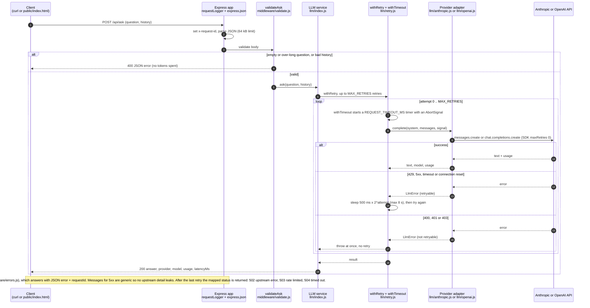

# LLM Practice App

[](https://github.com/georgejpark/llm-practice-app/actions/workflows/ci.yml)
[](LICENSE)

## What it is

A small Node.js service that answers questions through an LLM. It exposes one JSON endpoint and a minimal web page, and it is built the way a production service would be: configuration from the environment, input validation, timeouts and retries around the model call, structured errors, request logging, and tests that run without a network connection.

The provider is pluggable. It ships with adapters for **Claude (Anthropic)** and **OpenAI**; switch with one environment variable. Claude is the default provider and the default model id is `claude-opus-5-5` (set in `src/config.js`); `ANTHROPIC_MODEL` accepts any current Claude id, for example `claude-sonnet-5-5` or `claude-haiku-5-5`.

## How a request flows

The diagram follows the code: `src/app.js` -> `src/middleware/validate.js` -> `src/llm/index.js` -> `src/llm/retry.js` -> `src/llm/anthropic.js` or `src/llm/openai.js`, with `src/middleware/errors.js` catching whatever is thrown.



## Run it

Requires Node 20 or newer (`"engines": { "node": ">=20" }` in `package.json`). The scripts, exactly as defined in `package.json`:

| Command | Runs | Purpose |
|---|---|---|
| `npm install` | (npm) | installs `express`, `dotenv`, `@anthropic-ai/sdk`, `openai` |
| `npm test` | `node --test` | 13 tests against a fake provider: no API key, no network |
| `npm start` | `node src/server.js` | serves `http://localhost:3000` |
| `npm run dev` | `node --watch src/server.js` | same, restarting when a file changes |

```bash
cp .env.example .env        # then put your API key in .env
npm install
npm test                    # 13 tests, no API key needed
npm start                   # http://localhost:3000
```

Try it:

```bash
curl -s localhost:3000/api/health

curl -s -X POST localhost:3000/api/ask \
  -H 'content-type: application/json' \
  -d '{"question":"In one sentence, what is a Kubernetes operator?"}'
```

Or open `http://localhost:3000` in a browser for a simple chat page that keeps conversation history.

### Environment variables

Names only; values belong in `.env`, which is git-ignored.

- **Required for `npm start`**: `ANTHROPIC_API_KEY` (Claude, the default), or `OPENAI_API_KEY` when `LLM_PROVIDER=openai`. The server refuses to start without the key for the selected provider.
- **Optional**: `LLM_PROVIDER`, `ANTHROPIC_MODEL`, `OPENAI_MODEL`, `PORT`, `REQUEST_TIMEOUT_MS`, `MAX_RETRIES`. Defaults are in the Configuration table below.
- **None for `npm test`**: the tests inject a fake provider.

### Continuous integration

[`.github/workflows/ci.yml`](.github/workflows/ci.yml) runs `npm test` on Node 20 and 22 for every push and pull request to `main`. It uses no secrets, because the tests never call a real provider.

## API

### `POST /api/ask`

Request body:

```json
{
  "question": "What is my name?",
  "history": [
    { "role": "user", "content": "My name is George." },
    { "role": "assistant", "content": "Hi George." }
  ]
}
```

`history` is optional (max 20 messages). `question` is required (max 4,000 characters).

Response:

```json
{
  "answer": "Your name is George.",
  "provider": "anthropic",
  "model": "claude-opus-5-5",
  "usage": { "inputTokens": 42, "outputTokens": 7 },
  "latencyMs": 812
}
```

Errors are always JSON with an `error` message (plus a `requestId` for anything that fails after validation), and never include stack traces or upstream details. Every response also carries an `x-request-id` header.

| Status | When |
|---|---|
| 400 | Invalid input (missing/empty/over-long question, malformed history) |
| 500 | Provider misconfigured (for example a bad API key) |
| 502 | Upstream provider error after retries |
| 503 | Provider rate limit after retries |
| 504 | Provider timed out after retries |

### `GET /api/health`

Returns `{ ok, provider, model }`.

## Configuration

All settings come from environment variables (see `.env.example`):

| Variable | Default | Purpose |
|---|---|---|
| `LLM_PROVIDER` | `anthropic` | `anthropic` or `openai` |
| `ANTHROPIC_API_KEY` / `ANTHROPIC_MODEL` | – / `claude-opus-5-5` | Claude settings |
| `OPENAI_API_KEY` / `OPENAI_MODEL` | – / `gpt-4o-mini` | OpenAI settings |
| `PORT` | `3000` | HTTP port |
| `REQUEST_TIMEOUT_MS` | `30000` | Per-attempt timeout for the model call |
| `MAX_RETRIES` | `2` | Retries on rate limit / 5xx / timeout, with exponential backoff |

## Project layout

```
src/
  server.js            entry point: config -> provider -> app -> listen, graceful shutdown
  app.js               builds the Express app (tests inject a fake provider here)
  config.js            reads and validates environment variables
  routes/ask.js        POST /api/ask and GET /api/health
  middleware/
    validate.js        request body validation (fail fast, before spending tokens)
    errors.js          request id + logging, and the JSON error handler
  llm/
    index.js           provider factory + the ask() service (system prompt, timeout, retry)
    anthropic.js       Claude adapter
    openai.js          OpenAI adapter
    retry.js           LlmError, withTimeout, withRetry, isRetryable
public/index.html      minimal chat UI
test/
  app.test.js          HTTP tests against the real app with a fake provider
  retry.test.js        unit tests for timeout and retry logic
proxmox/README.md      self-hosting notes: cloud-dependency check, LXC plan, test plan
.github/workflows/ci.yml  GitHub Actions: npm test on Node 20 and 22
```

## Design notes

**Provider abstraction.** Each adapter implements one method, `complete({ system, messages, signal })`, and returns `{ text, model, usage }`. The rest of the app only knows that interface. Adding a third provider is one file. Tests use a fake provider, so they are fast, deterministic, and free.

**Timeouts and retries are ours, not the SDK's.** Both SDKs are created with `maxRetries: 0` so retry behavior lives in one place (`retry.js`) and is testable. Only rate limits, 5xx responses, timeouts, and connection resets are retried; a 400 or 401 fails immediately because retrying it would not help.

**Validation before the model call.** An empty or over-long question is rejected with a 400 before any tokens are spent. History is capped so a client cannot push an unbounded context.

**Errors are mapped, not leaked.** Provider errors are converted to `LlmError` with an HTTP status for our client and a `retryable` flag for our retry loop. Clients see a short message and a request id; the log line has the detail.

**No secrets in code.** Keys come from the environment; `.env` is git-ignored.

## Running it on a homelab

[`proxmox/README.md`](proxmox/README.md) records the cloud-dependency check (there is none: the only outbound call is the paid model API, and both SDKs accept a local OpenAI-compatible server through `OPENAI_BASE_URL` / `ANTHROPIC_BASE_URL`), a one-container Proxmox plan, and the test plan used to sign it off.

## What I would do next with more time

- Streaming responses (SSE) so the UI shows tokens as they arrive.
- A per-client rate limit and a daily token budget.
- Conversation storage (Redis or Postgres) instead of client-held history.
- Prompt and model configuration per use case, with an evaluation set of known-good answers run in CI.
- OpenTelemetry traces around the model call, and a Dockerfile. (The GitHub Actions workflow that runs `npm test` on every pull request is now in place.)

## License

MIT, see [LICENSE](LICENSE).
